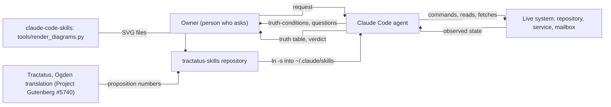
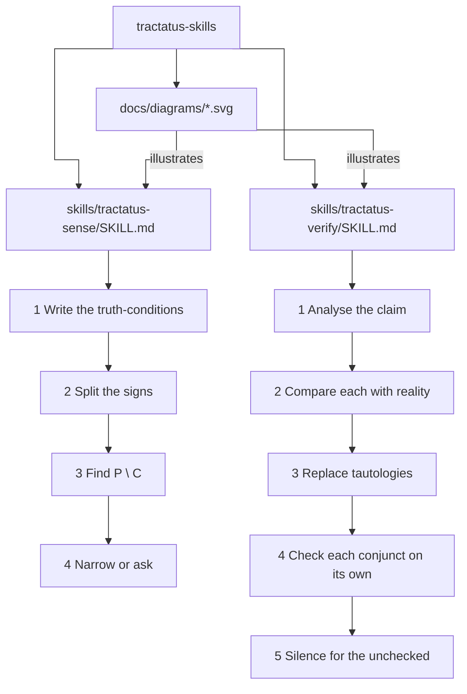
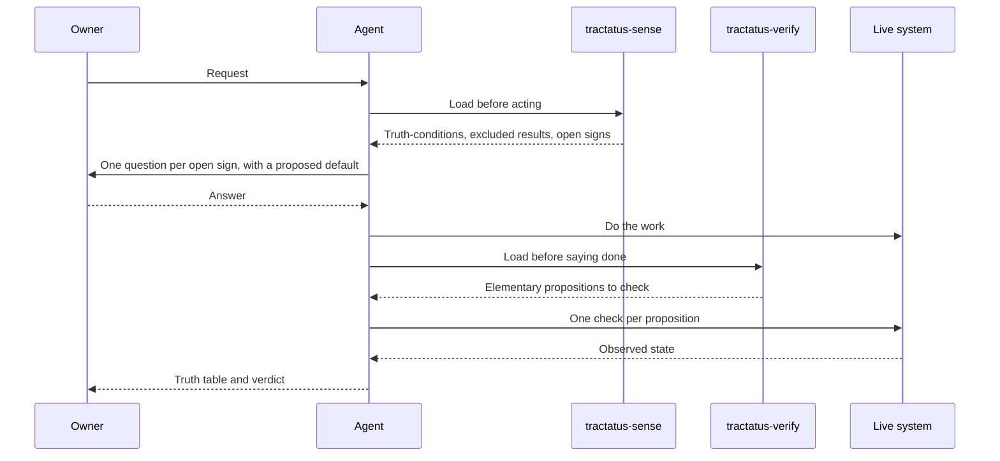

# tractatus-skills: architecture

This document describes the structure of the repository in the arc42 layout. The repository holds two Claude Code skills and two SVG diagrams; it holds no executable code.

## 1 Introduction and goals

The skills turn two ideas of Wittgenstein's *Tractatus Logico-Philosophicus* into working steps for an AI agent.

| Skill | When the agent runs it | Output |
|---|---|---|
| `tractatus-sense` | Before acting on a vague, broad or high-stakes request. | Truth-conditions, excluded results ($P \setminus C$), open questions with proposed defaults. |
| `tractatus-verify` | Before reporting work as done, or when a report has to be checked. | A truth table of elementary propositions (T / F / ?) with evidence. |

Quality goals:

1. The request is safe when every result that satisfies the words is a result the owner wants ($P \subseteq C$).
2. A "done" claim holds only when every elementary proposition in it was compared with reality.
3. Each skill stays short enough to read in one pass (40 and 36 lines).

## 2 Constraints

- Format: Claude Code skills, one `SKILL.md` per skill with `name` and `description` in the YAML front matter.
- Source text: proposition numbers refer to the C. K. Ogden translation (1922), public domain, Project Gutenberg #5740.
- The diagrams are generated outside this repository, by `tools/render_diagrams.py` in the claude-code-skills repository ([ADR 0003](adr/0003-diagrams-rendered-in-claude-code-skills.md)).
- The repository has no license file.

## 3 Context and scope



Out of scope: tooling, tests, enforcement by hooks.

## 4 Solution strategy

- Two independent skills, one at each end of a task: `tractatus-sense` narrows the set of acceptable results before the work, `tractatus-verify` checks the result after the work ([ADR 0002](adr/0002-check-before-and-after-the-work.md)).
- The steps cite the propositions of the Tractatus they come from (for example 4.024, 2.223, 5.134, 7).
- Each skill ends with a fixed output block, so the owner sees the same shape every time.

## 5 Building block view



| Building block | File | Lines |
|---|---|---|
| `tractatus-sense` | `skills/tractatus-sense/SKILL.md` | 40 |
| `tractatus-verify` | `skills/tractatus-verify/SKILL.md` | 36 |
| Diagrams | `docs/diagrams/tractatus-sense.svg`, `docs/diagrams/tractatus-verify.svg` | 33, 31 |

## 6 Runtime view

The main path of one task, with both skills:



## 7 Deployment view

The README installs each skill with a symbolic link:

```sh
git clone <repository URL> tractatus-skills
ln -s "$PWD/tractatus-skills/skills/tractatus-sense"  ~/.claude/skills/
ln -s "$PWD/tractatus-skills/skills/tractatus-verify" ~/.claude/skills/
```

Claude Code picks the skills up from `~/.claude/skills` in the next session.

## 8 Crosscutting concepts

- **Set notation:** $P$ is the set of results that satisfy the words of a request, $C$ the set the owner wants; the work is safe when $P \setminus C = \emptyset$.
- **Elementary proposition:** one observable state that a single check can show false.
- **Pictures are not comparisons:** a plan, a diff, a log line written by the same agent and the report itself do not count as evidence (`tractatus-verify`, step 2).
- **Silence for the unchecked:** a proposition without a check is marked `?` and stays out of any "done" (proposition 7).

## 9 Architecture decisions

- [ADR 0001: Skills as plain `SKILL.md` text](adr/0001-skills-as-plain-skill-md.md)
- [ADR 0002: Check before and after the work](adr/0002-check-before-and-after-the-work.md)
- [ADR 0003: Diagrams rendered in claude-code-skills](adr/0003-diagrams-rendered-in-claude-code-skills.md)

## 10 Quality requirements

| Quality | Scenario | Evidence |
|---|---|---|
| Falsifiability | A "done" report rests only on checks that could have shown it false. | `tractatus-verify`, steps 1 and 2. |
| No silent choice | A word with two meanings gets settled from the repository or by a question. | `tractatus-sense`, steps 2 and 4. |
| Proportion | A one-line request gets a one-line block. | `tractatus-sense`, section "Output". |

## 11 Risks and technical debt

- No license file: the terms of reuse are not stated.
- The SVG diagrams depend on a script in another repository; a change of the skills does not regenerate them.
- Nothing enforces the skills: the agent applies them only when its skill matcher picks them.

### Open questions

- None.

## 12 Glossary

| Term | Meaning |
|---|---|
| Truth-condition | An elementary proposition that must be true when the request is fulfilled. |
| $P \setminus C$ | Results that satisfy the words of the request but that the owner would reject. |
| Elementary proposition | One observable state; no other proposition follows from it (Tractatus 5.134). |
| Tautology | A sentence that stays true whatever happens, so it says nothing (Tractatus 4.461). |
| Truth table | The output of `tractatus-verify`: proposition, T / F / ?, evidence. |
